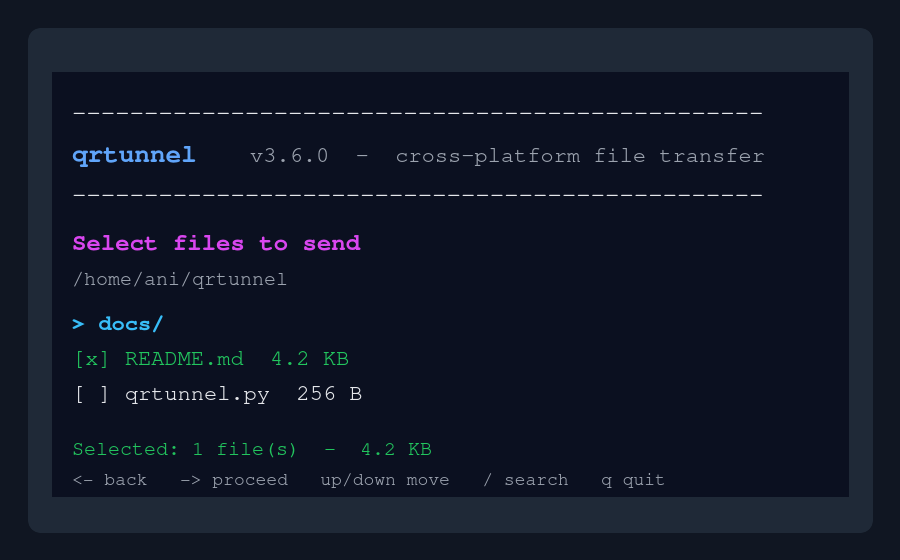

# qrtunnel

[](https://pypi.org/project/qrtunnel/)
[](https://pypi.org/project/qrtunnel/)
[](LICENSE)

**qrtunnel** is an elegant, cross-platform file sharing tool designed for immediate transfers between computers and mobile devices via QR codes. It seamlessly bridges local Wi-Fi and public WAN reverse tunnels without requiring third-party accounts, cloud storage uploads, or complex network configuration.

Whether you prefer a distraction-free **Bauhaus Web UI** in your browser, a fast keyboard-driven **Terminal User Interface (TUI)**, or direct **CLI scripting**, qrtunnel adapts to your workflow.

---

## Key Features

* **Unified Bauhaus Desktop Dashboard:** A clean, functional desktop web interface built on authentic Bauhaus design principles. Features a 3-tab layout (**Send**, **Receive**, and **History**), live speed and ETA telemetry, 4-digit PIN display, inline port configuration, and interactive QR emblems.
* **Interactive Terminal User Interface (TUI):** A keyboard-driven curses interface featuring directory navigation, instant file search (`/`), multi-file selection, and real-time ASCII progress bars.
* **Zero-Memory Streaming ZIP Engine:** Share entire folders or batches of files as on-the-fly streaming ZIP archives. Uses constant $\mathcal{O}(1)$ memory ($< 2\text{ MB}$ RAM regardless of archive size), achieves sub-4 ms Time-To-First-Byte (TTFB), pre-calculates exact byte lengths for native browser progress bars, and automatically uses Zip64 for archives over 4 GB.
* **Flexible Tunneling & Smart Routing:**
  * **LAN Mode:** Direct peer-to-peer transfers over local Wi-Fi/Ethernet with maximum gigabit throughput.
  * **SSH Tunnels:** Account-free public links via `localhost.run` on Linux and macOS.
  * **Cloudflare Tunnels:** Account-free public links via `cloudflared` quick tunnels.
  * **Ngrok Integration:** Enterprise-grade public tunneling with authtoken support and automatic Windows `winget` installation hints.
  * **Smart Mode:** Simultaneously binds LAN and WAN endpoints; the recipient device automatically detects and uses the fastest route.
* **Automated Staging Lifecycle & Disk Cleanup:** Temporary staged transfer files in `~/.qrtunnel/staged/` are automatically purged when transfers complete, the browser tab closes (`beforeunload` beacon), the terminal process exits, or servers shut down. Includes startup garbage collection and a dedicated `qrtunnel clean` CLI command.
* **4-Digit PIN Security:** Local network access is protected by a randomized 4-digit access code displayed exclusively on the host screen.
* **Two-Way Transfers:** Send files from computer $\rightarrow$ phone, or receive uploads from phone $\rightarrow$ computer with drag-and-drop dropzones.
* **High-Performance HTTP/1.1 Engine:** Built on persistent HTTP/1.1 connections, `TCP_NODELAY`, Linux kernel `sendfile` zero-copy transfer, thread-safe SHA-256 caching, and Server-Sent Events (SSE) telemetry.
* **Transfer Audit History:** Local logging with SHA-256 integrity checksum verification, byte counters, timestamps, and one-click history clearing.

---

## Project Structure & Architecture

QRTunnel is modularly structured across specialized subsystems:

```
qrtunnel/
├── src/qrtunnel/
│   ├── ui/                    # Bauhaus Web UI Presentation Layer
│   │   ├── theme.py           # Design tokens (warm ivory, ink, cadmium red, cobalt blue)
│   │   ├── dashboard.py       # Unified host desktop dashboard (Send, Receive, History)
│   │   ├── download.py        # Client download portal with streaming ZIP & SSE progress
│   │   ├── upload.py          # Client upload portal with drag-and-drop & speed tracker
│   │   ├── login.py           # 4-digit PIN authentication check page
│   │   ├── success.py         # Upload confirmation & receipt page
│   │   └── session.py         # Session closed overlay & SSE lifecycle hooks
│   ├── app.py                 # Application entry point, CLI parser, and process lifecycle
│   ├── browser.py             # Cross-platform browser launcher (App-mode & headless detection)
│   ├── config.py              # Central configuration, directories, and session constants
│   ├── constants.py           # Version metadata and terminal ANSI color escapes
│   ├── history.py             # Transfer audit trail, history formatting, and storage
│   ├── hotspot.py             # Ad-hoc Wi-Fi hotspot management
│   ├── keyboard.py            # Non-blocking cross-platform terminal keyboard input
│   ├── qr.py                  # Terminal ASCII QR generation and SVG vector rendering
│   ├── server.py              # HTTP/1.1 server, REST APIs, range requests, and staging lifecycle
│   ├── streams.py             # Chunked stream reader, multipart parser, and upload sinks
│   ├── sync.py                # Thread-safe transfer state manager and SSE broadcaster
│   ├── tui.py                 # Interactive curses terminal file browser & progress view
│   ├── tunnels.py             # Tunnel backends (LAN, SSH, Cloudflare, Ngrok) & auto-failover
│   ├── utils.py               # Fast UDP routing IP probe, SHA-256 caching, and disk cleanup
│   └── zip_stream.py          # Zero-memory on-the-fly streaming ZIP archive generator
├── benchmarks/                # Performance benchmarks and throughput stress tests
├── tests/                     # Comprehensive automated pytest suite (100+ tests)
├── DESIGN.md                  # Bauhaus design system & UX architecture specification
├── PERFORMANCE.md             # Benchmark report, kernel sendfile, and latency analysis
└── CHANGELOG.md               # Detailed release history and migration notes
```

---

## Installation

### Requirements

| Requirement | Minimum | Notes |
| :--- | :--- | :--- |
| **Python** | 3.8+ | Fully supported across Python 3.8 – 3.13 |
| **OS** | Linux, macOS, Windows | Cross-platform |
| `ssh` | Recommended | Required for account-free SSH mode on Linux/macOS |
| `cloudflared` | Optional | Required for Cloudflare tunnel mode (`-cloudflare`) |
| `ngrok` | Optional | Required for ngrok mode (`-ngrok`) |

### Install via pip / uv

```bash
# Standard installation
pip install qrtunnel

# Or using uv (recommended for speed)
uv pip install qrtunnel

# Or run directly with pipx without installing globally
pipx run qrtunnel
```

---

## Usage

### 1. Unified Bauhaus Web UI (Default)

Running `qrtunnel` with no arguments automatically spins up the server and opens the desktop dashboard in an isolated app window:

```bash
qrtunnel
```

```
============================================================
  qrtunnel
============================================================
  Web UI        : http://127.0.0.1:6969/ (Send & Receive)
  Access Code   : 4242
  Mode          : Send & Receive Files
  Status        : Opened in a new browser window
============================================================
[*] Server is running. Press 'q' or Ctrl+C in terminal or Stop in browser.
```

The desktop dashboard provides three integrated tabs:
1. **Send Files:** Drag and drop files or directories to share. Select tunnel mode (LAN, Cloudflare, SSH, Ngrok), adjust the port inline, and scan the generated QR code or copy the access URL.
2. **Receive Files:** Put the server in ingest mode to accept file uploads from phones or remote clients.
3. **History:** View past transfer records, file sizes, SHA-256 hashes, and clear logs with one click.

---

### 2. Interactive Terminal User Interface (TUI)

Prefer working purely in the terminal? Launch the interactive curses TUI:

```bash
qrtunnel tui
```



#### TUI Keybindings
* **Up / Down Arrows:** Navigate files and options.
* **Space / Enter:** Toggle file/directory selection in the file picker.
* **Right Arrow / Enter:** Confirm selection and move to mode/port setup.
* **Left Arrow:** Return to the previous screen.
* **/** (Slash): Open fuzzy search to filter files by filename.
* **Esc:** Exit search mode.
* **Q / Ctrl+C:** Terminate session and clean up.

---

### 3. Command Line Interface (CLI)

The CLI provides subcommands for fast terminal execution and headless scripting.

#### Sending Files
```bash
# General syntax
qrtunnel send <path1> <path2> ... [options]

# Share a single file on local Wi-Fi (LAN mode)
qrtunnel send presentation.pdf

# Share a folder using a specific port (e.g. 8080)
qrtunnel send ./documents -p 8080
# or use the shorthand syntax:
qrtunnel send ./documents -8080

# Share via Cloudflare quick tunnel (public, account-free)
qrtunnel send photo.jpg -cloudflare

# Share via SSH reverse tunnel (localhost.run)
qrtunnel send dataset.tar.gz -ssh

# Headless mode (no browser popup, suppress ASCII QR, auto-shutdown after 10 min)
qrtunnel send archive.zip --no-browser --no-qr --expire 600
```

#### Receiving Files
```bash
# Accept uploads into current directory
qrtunnel receive

# Save uploaded files into a specific directory
qrtunnel receive ~/Downloads/ReceivedFiles

# Receive via public Ngrok tunnel
qrtunnel receive ./uploads -ngrok
```

#### Viewing Transfer History
```bash
# View recent transfers
qrtunnel history

# Limit output to last 5 transfers
qrtunnel history --limit 5
```

#### Cleaning Staged Files & Disk Space
```bash
# Clean up temporary staged files and cache
qrtunnel clean

# Also purge transfer history
qrtunnel clean --all
```

---

## Options & Flags Reference

### Tunneling Options
| Flag | Description |
| :--- | :--- |
| `-lan` | **(Default)** Restricts transfer to the local network (Wi-Fi/Ethernet). Fastest speeds, protected by 4-digit PIN. |
| `-cloudflare` | Public tunnel via Cloudflare Quick Tunnels (`cloudflared`). Free, no account required. |
| `-ssh` | Public tunnel via `localhost.run`. Free, no account required (Linux/macOS). |
| `-ngrok` | Public tunnel via `ngrok`. Requires a free or paid ngrok authtoken. |

### Global Flags
| Flag | Description |
| :--- | :--- |
| `--port <PORT>`, `-p <PORT>`, `-<PORT>` | Specify custom server port (e.g., `-p 8080` or `-8080`). Default: `6969` (or auto-assigned). |
| `--no-browser` | Prevent the automatic launch of a browser window (ideal for SSH sessions and headless servers). |
| `--no-qr` | Suppress large ASCII QR code printing in the terminal; outputs access URLs only. |
| `--expire <SECONDS>` | Set an automatic shutdown timer after $N$ seconds of inactivity. |
| `-v`, `--version` | Display version information. |
| `-h`, `--help` | Display command usage and help. |

---

## Performance & Benchmarks

QRTunnel is engineered for maximum throughput and minimal resource usage:

* **Streaming ZIP Generation:** Up to **1,473 MB/s** throughput with zero in-memory buffer bloat ($> 138\times$ RAM reduction over standard in-memory approaches).
* **Linux Zero-Copy:** Uses Linux kernel `os.sendfile` with 1 MB chunking for sustained local throughput exceeding **3,300 MB/s**.
* **Zero Post-Upload Disk Latency:** On-the-fly SHA-256 calculation during streaming eliminates 100% of post-transfer disk re-reads.
* **Instant Sub-Millisecond LAN IP Resolution:** Replaced blocking DNS lookups with an instantaneous kernel UDP routing probe, ensuring sub-second startup on macOS, Windows, and Linux.

For in-depth performance analysis, profiling traces, and benchmark scripts, consult [PERFORMANCE.md](PERFORMANCE.md).

---

## Design System

The visual language of QRTunnel adheres to the **Bauhaus movement** (*Form follows function*):
* **Typography:** Geometric sans-serif grotesk UI typography paired with tabular monospace for technical metrics.
* **Color Palette:** Warm ivory canvas (`#F8F6F0`), deep ink charcoal (`#111215`), Cadmium Red (`#D22626`), Cobalt Blue (`#164785`), and Chrome Ochre (`#E5A110`).
* **Asymmetric Grid:** Structured layout balancing file controls against the monolithic QR stage.

Read full design specifications in [DESIGN.md](DESIGN.md).

---

## Security Model

* **Ad-Hoc Convenience:** QRTunnel is intended for short-lived, interactive transfers between your own devices.
* **4-Digit Access Code (PIN):** LAN transfers require recipients to enter a 4-digit code shown on the host machine, preventing unauthorized local network snooping.
* **Bearer Links for Public Tunnels:** Anyone with an active public tunnel URL can access the session while the host is running.
* **Isolated File Staging:** Temporary files are strictly constrained to `~/.qrtunnel/staged/` with strict path traversal guards. Staging cleanup never touches user source directories.

---

## Development & Contributing

### Setup
```bash
# Clone repository
git clone https://github.com/AniruthKarthik/qrtunnel.git
cd qrtunnel

# Install in editable mode with development dependencies
pip install -e ".[dev]"
# or using uv:
uv sync
```

### Running Tests & Linting
```bash
# Run pytest test suite
uv run pytest tests/ -v

# Run linter and formatting checks
uv run ruff check .
uv run ruff format --check .
```

---

## License

Distributed under the [MIT License](LICENSE). Copyright (c) 2026 Aniruth Karthik.
